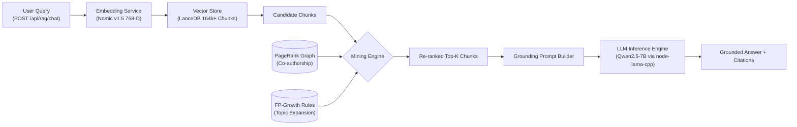

# Scientific Literature RAG - Backend Service

[](https://nestjs.com/)
[](https://www.typescriptlang.org/)
[](https://lancedb.com/)
[](https://nodejs.org/)

Production-grade Retrieval-Augmented Generation (RAG) backend engine built with **NestJS**, **TypeScript**, and **LanceDB**, engineered to perform semantic search, authority-boosted re-ranking, and grounded generation across 13,000+ scientific research papers.

---

## 🚀 Key Features

- **Asymmetric Vector Embedding**: Utilizes `nomic-ai/nomic-embed-text-v1.5` via `@xenova/transformers` with mandatory `search_query:` prefix processing for 768-D dense representations.
- **High-Performance Vector Retrieval**: Integrates `@lancedb/lancedb` to query over 164,800+ embedded chunks with Cosine similarity.
- **Data Mining & Graph Re-ranking**:
  - **PageRank Authority Boosting**: Leverages co-authorship & citation graph analysis (`graph_coauthorship.json`) to adjust chunk relevance scores dynamically.
  - **FP-Growth Query Expansion**: Extracts frequent co-occurring research topics (`association_rules.json`) to broaden retrieval recall.
- **Local LLM Inference**: Powered by `node-llama-cpp` running `Qwen2.5-7B-Instruct-Q4_K_M.gguf` with Metal / CUDA hardware acceleration.
- **Academic Grounding Engine**: Enforces strict grounding rules, eliminating hallucinations and ensuring accurate inline citations (`[Paper: {paper_id}]`).

---

## 🏛️ System Architecture



---

## 📂 Project Structure

```text
backend_rag/
├── src/
│   ├── app.controller.ts       # Main controller & healthcheck
│   ├── app.controller.spec.ts  # Controller unit tests
│   ├── app.module.ts          # Core application module
│   ├── app.service.ts         # Base service logic
│   ├── main.ts                # Application bootstrap entry point
│   ├── types/                 # Type declarations and DTOs
│   ├── modules/               # Feature modules (retrieval, llm, mining, rag)
│   └── common/                # Shared utilities, filters, and interceptors
├── test/                      # E2E test suites
├── .env.example               # Environment variable templates
├── nest-cli.json              # NestJS CLI configuration
├── package.json               # Dependencies and scripts
└── tsconfig.json              # TypeScript configuration
```

---

## ⚙️ Prerequisites & Environment Setup

### 1. Requirements
- **Node.js**: v20+ (v22 LTS recommended)
- **C++ Build Tools**: Required by `node-llama-cpp`
  - macOS: Xcode Command Line Tools (`xcode-select --install`)
  - Linux: `build-essential`, `cmake`
  - Windows: Visual Studio Build Tools with C++ desktop development

### 2. Configure Environment Variables
Copy `.env_example` to `.env` and adjust the paths:

```bash
cp .env_example .env
```

| Variable | Default Value | Description |
| :--- | :--- | :--- |
| `PORT` | `3001` | HTTP server port |
| `LANCEDB_PATH` | `../data/gold/lancedb` | Path to LanceDB vector table directory |
| `MINING_PATH` | `../data/gold/mining` | Path to data mining artifacts (`graph_coauthorship.json`, etc.) |
| `MODEL_PATH` | `../model/qwen2.5-7b-instruct-q4_k_m.gguf` | Path to local GGUF model file |
| `GPU_LAYERS` | `99` | Number of model layers offloaded to GPU (Metal/CUDA) |
| `CONTEXT_SIZE` | `4096` | Context window size for LLM inference |
| `DEFAULT_TOP_K` | `5` | Default number of chunks retrieved per query |
| `USE_AUTHORITY_BOOST` | `true` | Enable PageRank authority score re-ranking |

---

## 🛠️ Installation & Execution

```bash
# 1. Install dependencies
npm install

# 2. Run in development watch mode
npm run start:dev

# 3. Build for production
npm run build

# 4. Run in production mode
npm run start:prod
```

---

## 🧪 Testing

```bash
# Run unit tests
npm run test

# Run tests in watch mode
npm run test:watch

# Generate code coverage report
npm run test:cov

# Run End-to-End (E2E) tests
npm run test:e2e
```

---

## 📡 API Reference

### Health Check
- **Endpoint**: `GET /`
- **Response**: `Hello World!`

### RAG Chat / Generation
- **Endpoint**: `POST /api/rag/chat`
- **Request Body**:
```json
{
  "query": "What are the latest techniques in diffusion models for video generation?",
  "top_k": 5,
  "use_mining_boost": true
}
```
- **Response**:
```json
{
  "answer": "Recent techniques in video diffusion models focus on spatio-temporal attention...",
  "citations": [
    {
      "paper_id": "arxiv:2401.xxxxx",
      "title": "Spatio-Temporal Diffusion for High-Fidelity Video",
      "authors": ["Author A", "Author B"],
      "section": "method",
      "similarity_score": 0.884,
      "authority_boost": 0.052
    }
  ],
  "metrics": {
    "embedding_ms": 42,
    "retrieval_ms": 15,
    "generation_ms": 1120,
    "total_ms": 1177
  }
}
```
